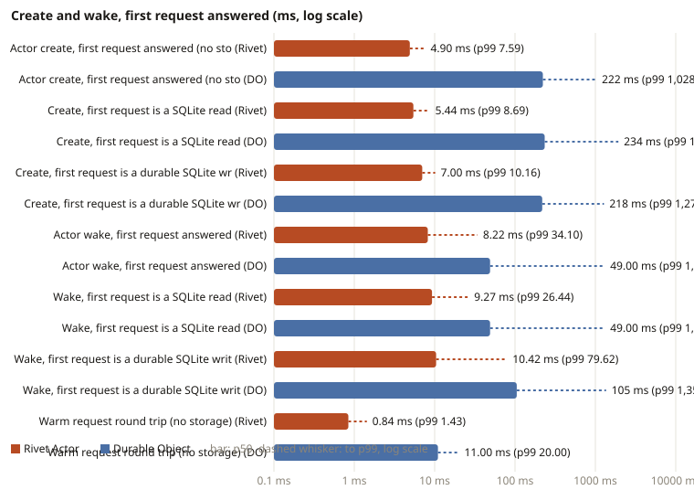
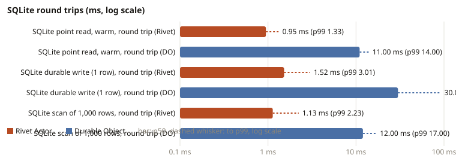

# Results: 2026-10-28

Generated by `scripts/report.mjs` from the raw samples in this directory. Latencies are milliseconds, p50 / p90 / p99, nearest rank over successful samples, no trimming. n is the number of successful samples that qualified (a create or wake sample qualifies only when the actor's own `cold` flag proves a fresh instance).

## Latency

| Metric | Rivet Actor | n | Rivet measures | Durable Object | n | DO measures |
| --- | --- | ---: | --- | --- | ---: | --- |
| Actor create, first request answered (no storage) | **4.90 / 7.18 / 7.59** | 1500 | client to reply, new keyed actor | **222 / 394 / 1,028** | 200 | Worker to DO round trip, named id (unique id below) |
| Actor create, unique id (DO only) | **-** | - |  | **169 / 258 / 875** | 200 | Worker to DO, newUniqueId |
| Create, first request is a SQLite read | **5.44 / 7.74 / 8.69** | 1200 | client to reply, SELECT on the new table | **234 / 783 / 1,936** | 200 | Worker to DO, SELECT in the first call |
| Create, first request is a durable SQLite write | **7.00 / 9.14 / 10.16** | 1200 | client to reply, INSERT then reply | **218 / 326 / 1,278** | 200 | Worker to DO, INSERT in the first call |
| Actor wake, first request answered | **8.22 / 12.66 / 34.10** | 1200 | client to reply, after at least 10 s asleep | **49.00 / 399 / 1,306** | 200 | Worker to DO, after at least 10 min idle, first call reads one row |
| Wake, first request is a SQLite read | **9.27 / 14.07 / 26.44** | 1200 | client to reply, SELECT of the stored row | **49.00 / 399 / 1,306** | 200 | Worker to DO, read |
| Wake, first request is a durable SQLite write | **10.42 / 16.80 / 79.62** | 1200 | client to reply, INSERT then reply | **105 / 303 / 1,358** | 200 | Worker to DO, write |
| Warm request round trip (no storage) | **0.84 / 1.21 / 1.43** | 2000 | client to reply, running actor (get) | **11.00 / 13.00 / 20.00** | 300 | Worker to DO, no-op call on a running DO |
| Warm request round trip, getOrCreate | **0.78 / 1.17 / 1.34** | 2000 | client to reply, running actor (getOrCreate) | **-** | - |  |
| SQLite point read, warm, in the actor | **0.08 / 0.25 / 0.41** | 1200 | SQL interval inside the actor | **-** | - | in-DO wall time: see the Cloudflare analytics table |
| SQLite point read, warm, round trip | **0.95 / 1.15 / 1.33** | 1200 | client to reply | **11.00 / 12.00 / 14.00** | 300 | Worker to DO |
| SQLite durable write (1 row), in the actor | **0.68 / 0.75 / 1.07** | 1200 | SQL interval inside the actor, autocommit, actor woken once | **-** | - | in-DO wall time: see the Cloudflare analytics table |
| SQLite durable write (1 row), round trip | **1.52 / 1.65 / 3.01** | 1200 | client to reply, actor woken once | **30.00 / 32.00 / 92.00** | 300 | Worker to DO, INSERT in one call |
| SQLite scan of 1,000 rows, round trip | **1.13 / 1.26 / 2.23** | 1000 | client to reply, 128 B rows | **12.00 / 14.00 / 17.00** | 300 | Worker to DO, 256 B rows |

## Throughput

Rivet rates are successful requests over the wall time of the block, closed loop, measured on the runner VM inside the cluster. Durable Object rates use the Worker-timed duration of each call, like the latency rows, so the client's internet round trip to Cloudflare is excluded. A closed loop of c concurrent callers completes c / mean duration calls per second (Little's law), so a DO burst rate is c × 1000 / mean Worker ms and the sequential write rate is 1000 / mean Worker ms, scaled by the fraction of calls that succeeded. Rivet burst creates are held actors (no sleep), so no teardown overlaps the creates.

| Metric | Rivet | Rivet p50 ms | errors | Durable Objects | DO p50 ms | errors |
| --- | ---: | ---: | ---: | ---: | ---: | ---: |
| Burst creates at concurrency 1 | **173/s** | 4.93 | 0 | **3.4/s** | 221 | 0 |
| Burst creates at concurrency 8 | **784/s** | 7.49 | 0 | **26.3/s** | 225 | 0 |
| Burst creates at concurrency 32 | **1,435/s** | 22.84 | 0 | **114/s** | 217 | 0 |
| Burst creates at concurrency 128 | **1,252/s** | 90.41 | 0 | **520/s** | 219 | 0 |
| Sequential durable writes on one actor (woken once) | **646/s** | 1.50 | 0 | **25.8/s** | 28.00 | 0 |

## Cloudflare: Worker clock against Cloudflare's own wall times

| Case | Worker clock p50 / p90 / p99 (n) | CF Worker wall p50 / p90 / p99 | CF in-DO wall p50 / p90 / p99 | client from Azure p50 (noop p50) |
| --- | --- | --- | --- | --- |
| name/raw cold | 222 / 394 / 1,028 (200) | 220 / 391 / 1,028 | 97.63 / 179 / 922 | 235 (12.28) |
| unique/raw cold | 169 / 258 / 875 (200) | 170 / 269 / 944 | 137 / 182 / 600 | 184 (12.28) |
| name/read cold | 234 / 783 / 1,936 (200) | 239 / 859 / 1,936 | 104 / 359 / 1,657 | 246 (12.28) |
| name/write cold | 218 / 326 / 1,278 (200) | 220 / 354 / 1,447 | 96.60 / 205 / 1,075 | 235 (12.28) |
| name/raw warm | 11.00 / 14.00 / 43.00 (70) | 13.43 / 34.51 / 742 | 5.88 / 12.06 / 733 | 23.27 (12.28) |
| wake/read cold | 49.00 / 399 / 1,306 (200) | 49.90 / 423 / 1,467 | 38.14 / 193 / 964 | 62.04 (11.01) |
| wake/write cold | 105 / 303 / 1,358 (200) | 106 / 303 / 1,426 | 93.84 / 192 / 1,159 | 117 (11.82) |
| ping/1 sql | 11.00 / 13.00 / 20.00 (300) | 11.92 / 13.61 / 19.86 | 8.48 / 9.63 / 23.29 | 22.50 (11.68) |
| point_read/1 sql | 11.00 / 12.00 / 14.00 (300) | 11.25 / 12.53 / 14.15 | 8.42 / 9.44 / 13.57 | 22.09 (11.68) |
| scan/100 sql | 11.00 / 12.00 / 28.00 (300) | 11.24 / 12.95 / 28.64 | 8.45 / 9.41 / 19.20 | 22.25 (11.68) |
| scan/1000 sql | 12.00 / 14.00 / 17.00 (300) | 12.87 / 15.56 / 18.21 | 9.25 / 9.86 / 14.11 | 24.50 (11.68) |
| insert/1 sql | 30.00 / 32.00 / 92.00 (300) | 30.73 / 32.35 / 92.37 | 27.13 / 28.35 / 296 | 42.07 (11.68) |

DO placement by colo (from Cloudflare analytics): name/raw/cold: EWR 78, IAD 122; unique/raw/cold: EWR 82, IAD 118; name/read/cold: EWR 84, IAD 116; name/write/cold: EWR 83, IAD 117; wake/read/cold: EWR 76, IAD 124; wake/write/cold: EWR 79, IAD 117; ping/1/sql: EWR 300; point_read/1/sql: EWR 300; scan/100/sql: EWR 300; scan/1000/sql: EWR 300; insert/1/sql: EWR 300.

## Rivet: in-actor intervals

| Case | client to reply p50 / p90 / p99 (n) | SQL interval in the actor | handler | notes |
| --- | --- | --- | --- | --- |
| create, ping | 4.90 / 7.18 / 7.59 (1500) | - | 0.00 / 0.01 / 0.01 |  |
| create, first SELECT | 5.44 / 7.74 / 8.69 (1200) | 1.58 / 2.17 / 2.33 | 1.59 / 2.18 / 2.34 |  |
| create, first INSERT | 7.00 / 9.14 / 10.16 (1200) | 3.02 / 3.66 / 4.17 | 3.04 / 3.68 / 4.19 |  |
| wake 10 s, ping | 8.22 / 12.66 / 34.10 (1200) | - | 0.00 / 0.00 / 0.01 |  |
| wake 10 s, first SELECT | 9.27 / 14.07 / 26.44 (1200) | 0.07 / 0.08 / 0.10 | 0.07 / 0.08 / 0.12 |  |
| wake 10 s, first INSERT | 10.42 / 16.80 / 79.62 (1200) | 1.31 / 2.72 / 2.93 | 1.32 / 2.73 / 2.94 |  |
| warm ping (get) | 0.84 / 1.21 / 1.43 (2000) | - | 0.00 / 0.00 / 0.01 |  |
| warm ping (getOrCreate) | 0.78 / 1.17 / 1.34 (2000) | - | 0.00 / 0.00 / 0.01 |  |
| warm point read | 0.95 / 1.15 / 1.33 (1200) | 0.08 / 0.25 / 0.41 | 0.09 / 0.25 / 0.42 |  |
| autocommit insert, actor woken once | 1.52 / 1.65 / 3.01 (1200) | 0.68 / 0.75 / 1.07 | 0.69 / 0.76 / 1.08 |  |
| 5,000 sequential inserts, actor woken once | 1.50 / 1.63 / 1.89 (5000) | 0.69 / 0.75 / 0.93 | 0.70 / 0.76 / 0.94 |  |
| 1,000-row scan | 1.13 / 1.26 / 2.23 (1000) | 0.54 / 0.58 / 1.55 | 0.55 / 0.59 / 1.55 |  |

## Charts

